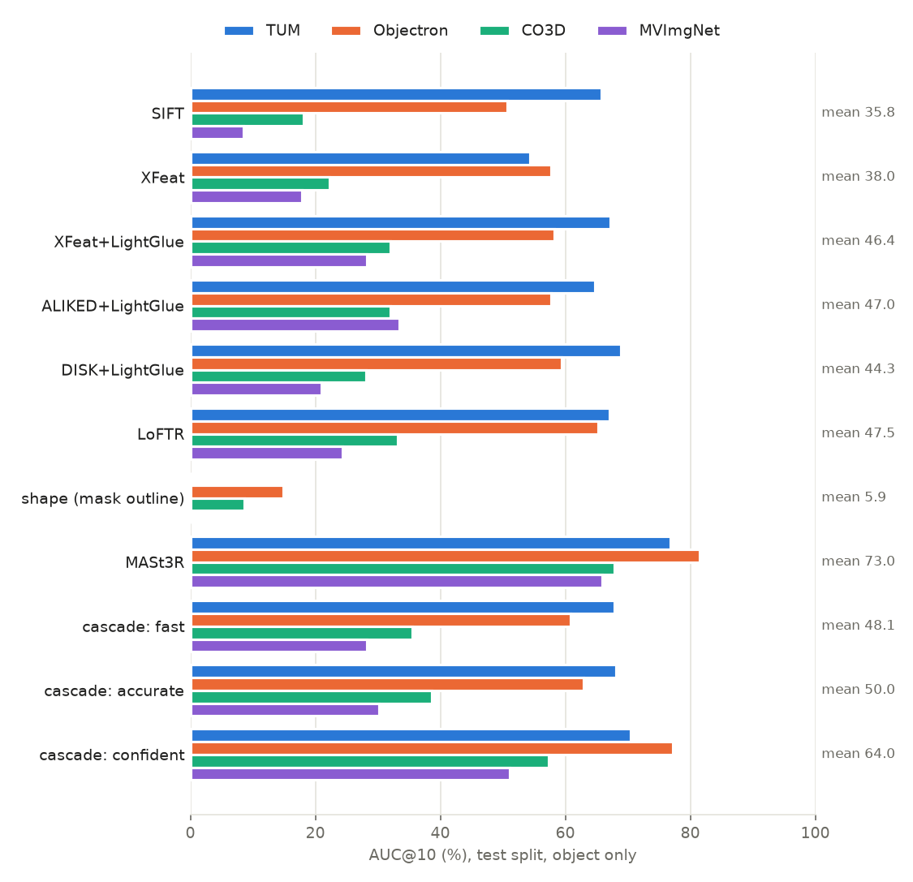

# Relative pose of a small object from two views (CS6350 TPA-12)

Given two RGB photos of a small, near-planar object (a book, a phone, a key, a cereal box)
and the camera intrinsics K, estimate the **relative pose** between the two views (rotation
R and translation direction t, with X_cam2 = R X_cam1 + t, OpenCV convention). Also report
the **reprojection error** of the matched points and, if the object's size is known, the
translation in metres.

Everything runs on a laptop CPU, uses only public real-image datasets with ground-truth
poses, and is scored on pairs that were never used for tuning.



The numbers behind this figure are in [results/overview.md](results/overview.md), which
`scripts/report.py` regenerates from the per-pair results.

---

## 1. Quick start

```
python -m venv venv
venv\Scripts\python.exe -m pip install -r requirements.txt

venv\Scripts\python.exe run.py view1.jpg view2.jpg --focal 1450 --box1 300 200 900 700 --box2 350 180 950 690
venv\Scripts\python.exe run.py a.jpg b.jpg --K results\calibration\camera.json --mask1 a.png --mask2 b.png --method mast3r --size 0.15 --save matches.jpg
```

`run.py` prints R, the t direction, the rotation angle and the RMS reprojection error of
the inlier matches. With `--size` (the object's longest side, in metres) it also prints t in
metres. `--save` draws the inlier matches and `--json` writes everything to a file.

| `--method` | what runs | CPU time per pair |
|---|---|---|
| `fast` | cascade: XFeat+LightGlue, then SIFT, then outline | ~0.5 s |
| `accurate` (default) | cascade: XFeat+LightGlue, then outline, then SIFT, then LoFTR | ~1-3 s |
| `confident` | XFeat+LightGlue, then SIFT, then outline. If the learned confidence is low for all three, MASt3R | ~0.5 s typical, ~8 s mean |
| `mast3r` | MASt3R dense 3D matching | ~20 s |
| `sift`, `orb`, `xfeat`, `xfeat_lg`, `aliked_lg`, `disk_lg`, `loftr` | a single matcher | 0.1-5 s |

**Object only.** Give the object's region in each image with `--mask1/--mask2` (any
binary or alpha PNG) or `--box1/--box2`. Then only points on the object are matched,
which is the task. Without a region the whole image is used ("with surroundings"). That
is a different problem: it only gives the object's pose if the object stays still
relative to the background.

MASt3R needs its code in `external/mast3r` and the weights in `models/mast3r`. These
folders are not in the repository; see section 6.

### Live webcam mode

```
venv\Scripts\python.exe scripts\webcam.py --make-board      (writes a checkerboard to print or show on a phone)
venv\Scripts\python.exe scripts\webcam.py --calibrate       (Zhang calibration -> results\calibration\webcam.json)
venv\Scripts\python.exe scripts\webcam.py --K results\calibration\webcam.json --size 0.15
```

1. Press **r** and draw a box around the object. That frame becomes the reference.
2. Move the object, or the camera.
3. Every new frame's pose relative to the reference is shown live:
   - rotation angle, and rotation about the camera's x, y and z axes;
   - translation direction, or translation in metres with `--size`;
   - inliers and reprojection error, with the object's axes drawn on it.

Other keys: **m** switches method, **s** saves a snapshot, **q** quits.

With the camera still, R and t are the object's own motion in the camera's axes (x right,
y down, z forward). The box follows the object: after each good estimate it becomes the
box around the inlier matches. The pose runs in a background thread, about 2 estimates
per second with XFeat+LightGlue, while the video stays at full frame rate.

`--replay co3d/handbag/seq08` feeds a dataset video through the same tracker and scores
every frame against the ground truth. On that handbag sequence, rotation errors are
0.4–1° for up to 30° of rotation, and 2–5° up to 55°. Beyond that the visible side of the
object changes and tracking is lost (results/webcam/).

---

## 2. Method

```
images + object regions
  -> crop around the object (keeps resolution on small objects)
  -> match keypoints (one of 8 matchers, or a cascade of them)
  -> robust model fit with MAGSAC++:  homography H (planar)  and  essential matrix E (3D)
  -> choose H or E per pair with GRIC
  -> decompose into (R, t); cheirality check picks the physical solution
  -> Levenberg-Marquardt refinement of (R, t) on the inliers
  -> reprojection error of the inliers;  optional metric scale
```

* **Matchers.** The classical baseline is SIFT (and ORB). The learned sparse matchers are
  XFeat, plus XFeat, ALIKED and DISK each paired with LightGlue. The learned dense matcher
  is LoFTR. MASt3R is a 3D foundation model that regresses a point map for both views and
  matches densely in 3D. There is also an outline-only method ("shape") for textureless
  rectangles such as phones: it fits a homography to the mask's outline corners.
  ([src/pipeline/match.py](src/pipeline/match.py),
  [src/pipeline/shape.py](src/pipeline/shape.py))
* **Planar vs general model.** A near-planar object fits a homography, which is better
  conditioned with few matches. If the object has real depth relief, or the views are far
  apart, the essential matrix is right. GRIC (Torr's Geometric Robust Information Criterion)
  scores both models on the same matches and picks one for each pair.
  [results/experiments/models.md](results/experiments/models.md) tests this choice against
  always H or always E. ([src/pipeline/estimate.py](src/pipeline/estimate.py),
  [src/pipeline/geometry.py](src/pipeline/geometry.py))
* **Planar twin check.** When GRIC chooses E, the essential matrix is not unique if the
  object is (nearly) flat. Both physically valid decompositions of the plane's homography
  fit every point on the plane, and E-estimation can return either one. The live webcam
  test exposed this: on a book, the essential matrix sometimes returned 2–5° of rotation
  when the truth was 28–68°.

  The check works like this
  ([src/pipeline/geometry.py](src/pipeline/geometry.py) `planar_twin`):
  - If E's pose coincides with a decomposition that the plane rules out (the plane would
    be behind a camera), it is replaced by the best physically valid one.
  - If it coincides with a valid one, it is compared with that one's twin, using the
    evidence the H path uses: Sampson error first, then the "plane faces both cameras" prior.
  - A replacement is accepted only if it fits all matches within 3× E's own Sampson error.
    This protects 3D objects, where a pose derived from one plane cannot explain the
    off-plane points.

  The factor 3 was chosen on the tuning split. On test, the check raises every matcher's
  mean AUC@10 by 1–3 points, and XFeat+LightGlue on Objectron by 9 (49.3 → 58.2). No
  dataset loses more than 0.3 points. On the live book video, wrong near-zero rotations
  went from 5 of 17 estimates to 0 of 7.
* **Refinement.** Levenberg-Marquardt minimises a geometric pixel error over every
  inlier, and the result is kept only if it lowers the median error
  ([src/pipeline/refine.py](src/pipeline/refine.py)):
  - for E, the Sampson distance over 5 parameters: rotation as an axis-angle vector and t
    on the unit sphere;
  - for H, the symmetric transfer error over R, t/d and the plane normal, so the result
    stays a rigid motion seen through a plane.
* **Cascades.** No single matcher is best everywhere. A cascade tries methods in order and
  stops at the first pose with enough inliers. The order and the thresholds were searched
  over 268k designs on the tuning split only.
  ([src/pipeline/cascade.py](src/pipeline/cascade.py),
  [scripts/tune_cascade.py](scripts/tune_cascade.py))
* **Confidence model.** A gradient-boosted classifier predicts whether a method's pose is
  within 10° of the truth. Its inputs are match and inlier counts, inlier ratio,
  reprojection error, the GRIC margin, and how well the different methods' poses agree.
  The cascade then moves to the next, more expensive method only when the predicted
  confidence is low. ([scripts/confidence.py](scripts/confidence.py),
  [results/confidence/summary.md](results/confidence/summary.md))
* **Metric scale.** Two views fix t only up to scale. Two ways to recover it are compared
  ([src/pipeline/scale.py](src/pipeline/scale.py)):
  - a known object size: the triangulated points' extent along their main axis is matched
    to the given length;
  - MASt3R's metric depth.

  See [results/scale/summary.md](results/scale/summary.md).

---

## 3. Data and evaluation protocol

| dataset | objects used | ground truth | why it is here |
|---|---|---|---|
| [TUM RGB-D](https://cvg.cit.tum.de/data/datasets/rgbd-dataset) fr3 | flat/structured textured posters (near/far), checkerboard | motion capture (metric) | precise poses; planar scenes |
| [Objectron](https://github.com/google-research-datasets/Objectron) | book, cereal box, laptop | ARKit poses + 3D boxes (metric) | small near-planar objects in real homes |
| [CO3Dv2](https://github.com/facebookresearch/co3d) | cellphone, handbag | SfM poses + masks | phones: textureless, reflective |
| [MVImgNet](https://github.com/GAP-LAB-CUHK-SZ/MVImgNet) | key, watch | COLMAP poses + cut-out masks | very small objects |

* **Pairs.** Frame pairs are sampled with a fixed seed, stratified by viewpoint change
  (5-15°, 15-30° and 30-60° of relative rotation). Every method is scored on exactly the
  same pairs.
* **Tuning vs test.** Sequences 01-03 of every object (and the first 30% of each TUM
  video) are used for all tuning: thresholds, cascade designs, the confidence model and
  the choice of presets. All reported numbers are on the remaining **test** pairs.
* **Metric.** The pose error is the larger of the rotation error and the translation-direction
  error, in degrees. AUC@5/10/20 is the area under the "share of pairs solved vs error"
  curve up to that threshold, the standard measure from the SuperGlue and LoFTR papers.
  Failed pairs count as infinite error, and every table also shows the failure rate.
* **Object only.** Unless labelled "with surroundings", matches come only from the
  object's mask.

The datasets are downloaded by the `scripts/download_*.py` scripts. They fetch only the
needed sequences: CO3D and MVImgNet are read out of the remote zips with HTTP range
requests. MVImgNet's password is read from the `MVIMGNET_PASSWORD` environment variable
and is never stored.

---

## 4. Results

The headline numbers (test split, object only, AUC@10 in %) are below. The full table
with AUC@5/20, failure rates, median errors and reprojection errors is in
[results/overview.md](results/overview.md).

| method | TUM | Objectron | CO3D | MVImgNet | mean | median rot / t-dir error | s/pair (median / mean) |
|---|---|---|---|---|---|---|---|
| SIFT | 65.8 | 50.7 | 18.1 | 8.5 | 35.8 | 1.22° / 2.62° | 0.1 |
| XFeat+LightGlue | 67.2 | 58.2 | 32.0 | 28.3 | 46.4 | 1.82° / 3.40° | 0.5 |
| ALIKED+LightGlue | 64.7 | 57.8 | 32.1 | 33.5 | 47.0 | 1.27° / 2.57° | 2.0 |
| LoFTR | 67.1 | 65.2 | 33.1 | 24.4 | 47.5 | 1.41° / 3.12° | 5.4 |
| `fast` cascade | 67.8 | 60.9 | 35.5 | 28.3 | 48.1 | 1.86° / 3.61° | 0.6 / 0.7 |
| `accurate` cascade | 68.1 | 63.0 | 38.6 | 30.2 | 50.0 | 1.78° / 3.37° | 0.9 / 2.2 |
| **`confident` cascade** | 70.5 | 77.2 | 57.4 | 51.1 | **64.0** | 1.21° / 1.91° | 0.7 / 7.8 |
| **MASt3R** | **76.8** | **81.5** | **67.8** | **65.9** | **73.0** | **0.90° / 1.49°** | 20 / 22 |

The median reprojection error of the inlier matches is 0.4–0.6 px for every matcher, and
0.29 px for MASt3R. All these numbers include the planar twin check; the results before it
are kept in `results/_pretwin/`.

All cascades were tuned on the tuning pairs of all four datasets, with the planar twin check
on.

* **The most accurate method is MASt3R.** It solves almost every pair with sub-degree
  median errors on TUM and Objectron, at about 20 s per pair on CPU. It was trained on CO3D,
  so its CO3D numbers could be memorisation. But its gain on MVImgNet, which it never saw,
  is just as large ([results/experiments/mast3r.md](results/experiments/mast3r.md)).
* **The learned sparse matchers (ALIKED/XFeat + LightGlue) are clearly better than SIFT on
  the hard sets** (CO3D phones, MVImgNet keys and watches). SIFT is still competitive on
  well-textured planar scenes.
* **The cascades** beat every single matcher except MASt3R. `accurate` (50.0) is above
  LoFTR (47.5) at about a sixth of its median time, and `fast` (48.1) is above
  ALIKED+LightGlue (47.0) at a third of its time.
* **The confidence-gated cascade** (`confident`) is the best accuracy-per-second option. It
  sends only the pairs whose cheap pose looks doubtful, about a quarter, to MASt3R. That
  gives most of MASt3R's accuracy at about a third of its run time. It also accepts far
  fewer wrong answers than the inlier-count rule: 7% of test pairs end more than 20° off,
  against 19–21% for cheap-only designs. The run-time code reproduces the simulated
  decisions pair for pair.
* **The hardest objects** are keys and phones: tiny, shiny, with few features.
  Per-object tables are in each `results/<run>/summary.md`.

### Supporting experiments

All on the test split, AUC@10 in %.

**Planar (H) or 3D (E) model?**
([results/experiments/models.md](results/experiments/models.md))
Neither one is enough on its own. With ALIKED+LightGlue:

| model | AUC@10, all test pairs pooled | where it does well |
|---|---|---|
| homography (H) | 29.9 | flat posters at a distance (55.5) |
| essential matrix (E) | 44.3 | flat posters at a distance: only 18.6 |
| GRIC choice per pair | **44.9** | beats both overall |

GRIC chose H for 17% of the pairs. Before the planar twin check, E scored only 5.8 on the
distant flat posters, because it returned the wrong twin. The check closes most of the
gap to H, but not all of it.

**Object only vs with surroundings** (a labelled comparison;
[results/experiments/masks.md](results/experiments/masks.md))
Using the whole image raises ALIKED+LightGlue's AUC@10 on MVImgNet from 33 to 75. The
objects in these datasets sit still in a static scene, so the background moves with
the camera and gives many easy matches. That measures the camera's motion, not the
object's: it breaks as soon as the object moves. The main results therefore stay object only.

**Accuracy vs viewpoint change**
([results/experiments/angles.md](results/experiments/angles.md))
Between 30° and 60° of rotation, every sparse or dense matcher falls to 19–32. MASt3R
stays at 72.

**Is MASt3R's advantage memorisation?**
([results/experiments/mast3r.md](results/experiments/mast3r.md))
No. Its gain over the best other method is +35 on CO3D, which it was trained on, and
+32 on MVImgNet, which it never saw. On Objectron (+16) and TUM (+8) the other methods
are already good, so there is less to gain.

**Run time** (one session, same 24 pairs;
[results/experiments/timing.md](results/experiments/timing.md))

| method | median s/pair on CPU | mean s/pair |
|---|---|---|
| SIFT | 0.13 | 0.28 |
| XFeat+LightGlue | 0.56 | 0.61 |
| ALIKED+LightGlue | 1.8 | 1.7 |
| DISK+LightGlue | 4.7 | 4.4 |
| LoFTR | 5.8 | 6.6 |
| MASt3R | 23.7 | 23.6 |
| `fast` cascade | 0.80 | 0.83 |
| `accurate` cascade | 1.1 | 3.0 |

The `accurate` cascade's mean is much higher than its median, because LoFTR runs only on the
pairs where the cheaper stages fail. The `confident` cascade behaves the same way: its
median is about 0.7 s and its mean about 8 s, as most pairs stop after XFeat+LightGlue and
about a quarter go on to MASt3R.

**How wrong can K be?**
([results/sensitivity/summary.md](results/sensitivity/summary.md))
- A focal-length error of ±2% costs about 1 point of AUC; ±10% costs about 5–6.
- The principal point matters more. Shifting it by 5% of the image size costs about 7
  points, and by 10% the AUC almost halves.
- Our Zhang calibration, 2.3% off in focal length, is therefore good enough. Assuming the
  image centre is only safe if the real principal point is close to it.

**Metric scale** ([results/scale/summary.md](results/scale/summary.md))
- A known object length, matched to the extent of the triangulated points, recovers |t|
  with a median error of 18% on Objectron. The error is similar for books, cereal boxes
  and laptops (17–20%), and 59% of pairs are within 25%.
- MASt3R's metric depth is off by a median factor of about 1.5 on TUM and 3 on Objectron
  close-ups, even after correcting for focal length, so it is not usable for scale here.

**Confidence-gated cascade:** see the results above and
[results/confidence/summary.md](results/confidence/summary.md).

**Calibration:** see the section below and
[results/calibration/summary.md](results/calibration/summary.md).

### Calibration

`scripts/calibrate.py` runs Zhang's method on TUM's checkerboard sequence. The chosen
model has no distortion terms and uses all views. Its focal length is within 2.3% of TUM's
official value, with a corner RMS error of 0.22 px. The experiment also shows that this
board, which is almost always seen face-on, is close to Zhang's degenerate case: a K that
is 28% off reprojects held-out views almost as well as the official K. A low
reprojection error alone therefore does not prove a good calibration.

---

## 5. Limitations

* The pose comes from two views, so t has no scale without extra information. A known
  object size gives a typical error of about 18%. MASt3R's learned metric depth was off by
  1.5–3× on close-up objects, so it isn't used (see results/scale).
* Objectron's object masks are projections of the 3D box, not true silhouettes. That
  hurts the outline-based methods there (shape, and the outline size prior).
* Without texture (plain phone backs, dark watch faces) matching fails. The outline
  method only helps when the outline is a clean rectangle.
* MASt3R is accurate but slow on CPU, and it saw CO3D during training.
* The accuracy depends on K. A 5-10% focal error costs a measurable amount of AUC (see
  results/sensitivity).

---

## 6. Repository layout

```
run.py                   two images -> pose (command line)
src/loaders/             dataset readers: TUM, Objectron, CO3D, MVImgNet -> frame pairs with ground truth
src/pipeline/            matching, geometry, GRIC, refinement, cascade, shape, scale, metrics
scripts/                 downloads, calibration, evaluation, tuning, experiments, report
results/                 every run: pairs.csv (per pair), summary.md (tables), figures
data/  models/  external/   datasets, network weights, MASt3R code (not in git; see below)
```

To reproduce everything:

```
venv\Scripts\python.exe scripts\download_tum.py           (also download_objectron, download_co3d, download_mvimgnet)
venv\Scripts\python.exe scripts\calibrate.py
venv\Scripts\python.exe scripts\evaluate.py --name aliked_lg_ref --matcher aliked_lg --crop
venv\Scripts\python.exe scripts\tune_cascade.py
venv\Scripts\python.exe scripts\confidence.py
venv\Scripts\python.exe scripts\sensitivity.py
venv\Scripts\python.exe scripts\scale_eval.py
venv\Scripts\python.exe scripts\experiments.py all
venv\Scripts\python.exe scripts\report.py
```

The learned matchers' weights (XFeat, LightGlue, ALIKED, DISK, LoFTR) download
automatically through kornia and torch.hub. For MASt3R:
* clone https://github.com/naver/mast3r into `external/mast3r`, with its submodules;
* put the checkpoint `MASt3R_ViTLarge_BaseDecoder_512_catmlpdpt_metric` in
  `models/mast3r/`.
